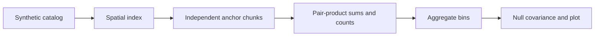

# Moving-Lens Analysis Pipeline

**A Python project for scalable statistical analysis, reproducible simulations, and HPC workflows**, inspired by computational methods in cosmology.

The pipeline operates on synthetic spatial data, combining neighbor searches, chunked pair statistics, permutation-based null tests, and covariance estimation.

**Research context:** This repository presents a simplified, self-contained demonstration of computational techniques developed in my PhD research. The full scientific analysis pipeline is part of ongoing work and is planned for public release alongside the associated publication.

**Skills:** NumPy · SciPy `cKDTree` · chunked processing · reproducible randomization · covariance estimation · Slurm job arrays · unit tests

## What it does

1. Generates a reproducible synthetic 2D point catalog with a spatially varying toy scalar measurement.
2. Splits the catalog into deterministic **anchor chunks** and finds neighboring points within a distance using `cKDTree`.
3. Computes **centered pairwise scalar products** in radial bins.
4. Performs deterministic permutation-based null trials and aggregates per-chunk **sufficient statistics**, correctly accounting for cross-chunk pairs using anchor ownership.
5. Produces a combined statistics CSV, null covariance matrix, and optional figure.



## Local quick start

Python 3.10+:

```bash
python -m pip install -r requirements.txt
python examples/run_demo.py --outdir demo_output
python -m unittest discover -s tests -v
```

Outputs: `catalog.npz`, `chunk_*.npz`, `summary.csv`, `null_covariance.csv`, and `summary.png` (if Matplotlib installed). The demo is deterministic for a fixed seed.

## HPC example

```bash
mkdir -p logs
python examples/generate_catalog.py --output demo_output/catalog.npz --n 10000
# On a Slurm cluster, edit paths/resources in slurm/ and then:
sbatch slurm/chunks.sbatch
# After the array finishes:
python -m portfolio.aggregate --input-dir demo_output/chunks --output-dir demo_output/results
```

Each independent job processes **a disjoint set of anchor indices**, but queries the full synthetic catalog; therefore unordered pairs are included exactly once, even across chunk boundaries. Aggregation adds numerators and denominators **before** taking ratios. A null realization applies a global permutation indexed by trial and seed, consistently across chunks.

## Repository layout

```text
portfolio/        reusable synthetic data, chunk analysis and aggregation modules
examples/         runnable demo and input generation
slurm/            portable example job-array script
configs/          demo-only settings
tests/            unit and integration tests
```

## License

Released under the MIT License. See [LICENSE](LICENSE).
